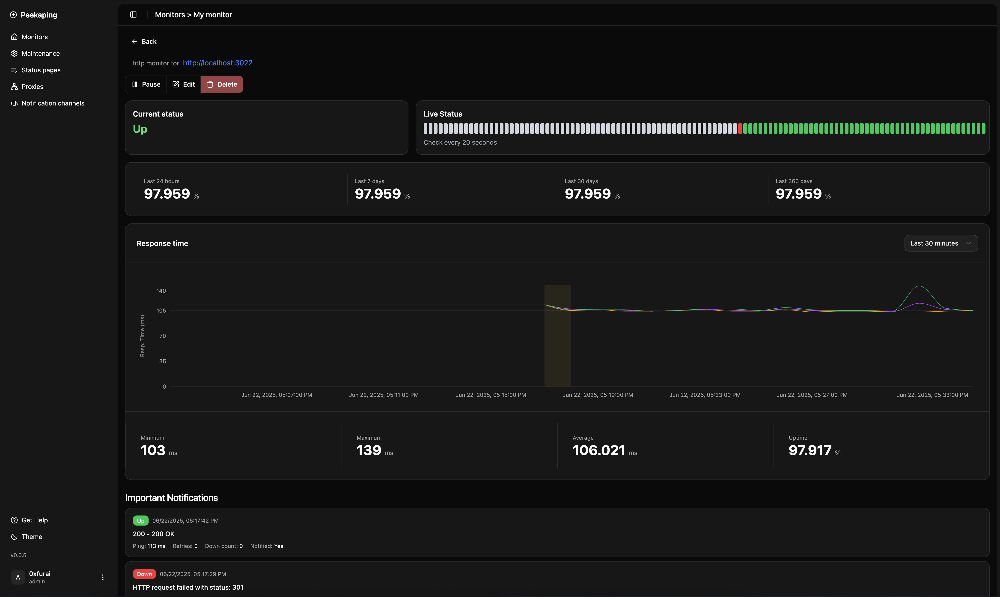

<div align="center">


# Peekaping

**Open-source, self-hosted uptime monitoring. A modern, API-first Uptime Kuma alternative built with Go and React.**

[Website](https://peekaping.com) · [Live demo](https://demo.peekaping.com) · [Docs](https://docs.peekaping.com) · [Discord](https://discord.gg/Xuv8b5AhPF)


</div>

Peekaping checks your websites, APIs, databases and message queues, alerts your team where it already talks when something goes down, and publishes status pages for your users. It runs on your own server, with your data in SQLite or PostgreSQL.



> [!WARNING]
> **Peekaping is in beta.** It's under active development and some features may change. Try it outside production first, and please [report the issues](https://github.com/0xfurai/peekaping/issues) you find: your feedback is what gets Peekaping to production-ready.

## Quick start (Docker + SQLite)

```bash
docker run -d --restart=always \
  -p 8383:8383 \
  -e DB_NAME=/app/data/peekaping.db \
  -v $(pwd)/.data/sqlite:/app/data \
  --name peekaping \
  0xfurai/peekaping-bundle-sqlite:latest
```

Then open http://localhost:8383. The image runs Peekaping in single mode: one process, as a non-root user, with no Redis. It serves the web app and the API on port 8383. For HTTPS, put a reverse proxy in front of it.

| Setup | Guide |
| --- | --- |
| Docker + SQLite | [docs.peekaping.com/self-hosting/docker-with-sqlite](https://docs.peekaping.com/self-hosting/docker-with-sqlite) |
| Docker + PostgreSQL | [docs.peekaping.com/self-hosting/docker-with-postgres](https://docs.peekaping.com/self-hosting/docker-with-postgres) |
| Kubernetes (Helm) | [docs.peekaping.com/self-hosting/kubernetes-helm](https://docs.peekaping.com/self-hosting/kubernetes-helm) |

These images run single mode, the default for new installs. Cluster mode (Kubernetes with Helm, or Docker Compose) is for installs that need to scale out. See [Deployment modes](https://docs.peekaping.com/self-hosting/deployment-modes) to choose.

MongoDB storage was removed. If you ran Peekaping on MongoDB, [move your data to SQLite or PostgreSQL](https://docs.peekaping.com/self-hosting/docker-with-mongo#move-to-sqlite-or-postgresql) before you upgrade.

Prefer a managed host? [](https://repocloud.io/details/peekaping/)

## Features

### Monitors

| Category | Monitors |
| --- | --- |
| Web & network | HTTP/HTTPS, TCP, Ping (ICMP), DNS, SMTP |
| Application & infrastructure | Push (incoming heartbeat), Docker container, gRPC, SNMP |
| Databases & caches | PostgreSQL, MySQL/MariaDB, Microsoft SQL Server, MongoDB, Redis |
| Messaging & streaming | MQTT broker, RabbitMQ, Kafka producer |

### Alert channels

| Category | Channels |
| --- | --- |
| Chat & collaboration | Slack, Discord, Telegram, Microsoft Teams, Google Chat, Mattermost, Matrix, Signal, WhatsApp (WAHA), LINE Messenger, WeCom |
| On-call & incidents | PagerDuty, Opsgenie, Grafana OnCall, PagerTree |
| Email, SMS & webhooks | Email (SMTP), SendGrid, Twilio, Webhook |
| Push notifications | ntfy, Gotify, Pushover, Pushbullet |

### Everything else

- **Status pages**, public or private, on your own domain
- **SVG status badges** for your READMEs and dashboards
- **Maintenance windows**, once or on a schedule, so planned work doesn't page anyone
- **Two-factor authentication** and **brute-force login protection**
- **TLS certificate expiry** notifications
- **API keys** and a REST API with an OpenAPI spec for everything in the app
- **Proxies** and **tags** to organize monitors
- A community **[Terraform provider](https://registry.terraform.io/providers/tafaust/peekaping/latest)**

## Why Peekaping

Peekaping started from our experience with [Uptime Kuma](https://github.com/louislam/uptime-kuma). We respect the project and what it gave the community, and we wanted to fix the limits teams hit when they scale it and wire monitoring into their DevOps processes.

- **API-first.** Every function in the app is available through the REST API, so you can automate it from CI/CD and Infrastructure as Code tools.
- **Fast and light.** The server is written in Go, which keeps CPU and RAM use low even with many monitors.
- **Typed end to end.** A compiled Go server and a typed React + TypeScript client make it stable and predictable.
- **Easy to extend.** The modular server adds new monitor types and notification channels without touching the core.
- **Your choice of storage.** SQLite for an easy start, PostgreSQL for production.

## Roadmap

### General

- [ ] Incidents
- [ ] Migration tool from Uptime Kuma
- [ ] Multiple users, groups and access levels
- [ ] Group monitors
- [ ] Homepage widget support (in progress)
- [ ] Gatus-like conditions

### Monitors

- [ ] HTTP(S) keyword and JSON query
- [ ] Steam
- [ ] GameDig
- [ ] Playwright

### Notification channels

- [ ] WhatsApp (Whapi)
- [ ] CallMeBot (WhatsApp, Telegram Call, Facebook Messenger)
- [ ] AliyunSMS (阿里云短信服务)
- [ ] DingDing (钉钉)
- [ ] ClickSend SMS
- [ ] Rocket.Chat


## Contributing

We welcome contributions! Please:

1. Fork the repository
2. Set up your environment with the [development guide](https://docs.peekaping.com/development). You need Go, Node.js and Bun, installed any way you like; `make setup` checks them.
3. Create a feature branch
4. Make your changes
5. Add tests if applicable
6. Submit a pull request

## Community and support

- **Bugs and feature requests:** [GitHub Issues](https://github.com/0xfurai/peekaping/issues)
- **Chat:** [Discord](https://discord.gg/Xuv8b5AhPF)
- **Dev logs and tips:** [@0xfurai on X](https://x.com/0xfurai)

[](https://x.com/0xfurai)

## License

This project is licensed under the MIT License. See the [LICENSE](LICENSE) file for details.

## Acknowledgments

- Inspired by [Uptime Kuma](https://github.com/louislam/uptime-kuma)
- Built with amazing open-source technologies
- Thanks to all contributors and users

---

## Choosing an Uptime Kuma alternative

### What to look for

Look at the technology stack and architecture first. Tools built with compiled languages (Go, Rust) are faster and use fewer resources. An API-first design is critical for automation and for CI/CD integration.

Make sure the tool supports the protocols you need to monitor (HTTP/HTTPS, TCP, databases, Docker, gRPC) and the channels your team uses. Flexible storage (SQLite or PostgreSQL), security features (two-factor login, API keys), a modular architecture you can extend, and an active community with good documentation matter too.

### How to choose

Decide how you'll deploy it. Self-hosted tools give you full control over your data and deep customization, but you run and maintain them. Cloud services set up quickly and update themselves, but limit customization and cost a monthly subscription.

Then test it in practice: deploy it, create real monitors of different types, simulate failures and see how fast they're detected. Check resource use under load, how easy the API is to integrate, and the quality of the interface. Teams choose Peekaping when they need high performance, an API-first architecture and no vendor lock-in.

<div align="center">

**Made with 💜 by the Peekaping team**

</div>
